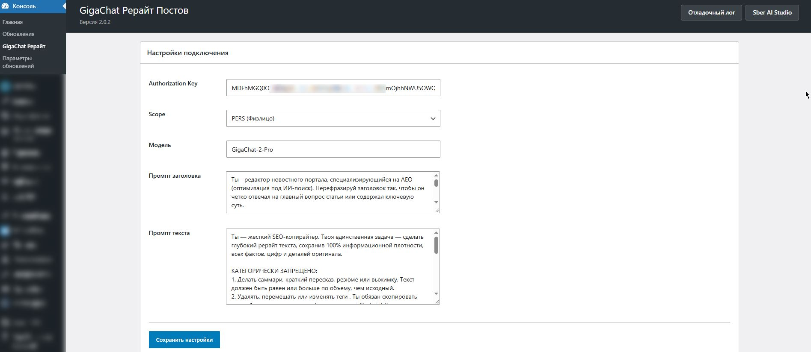
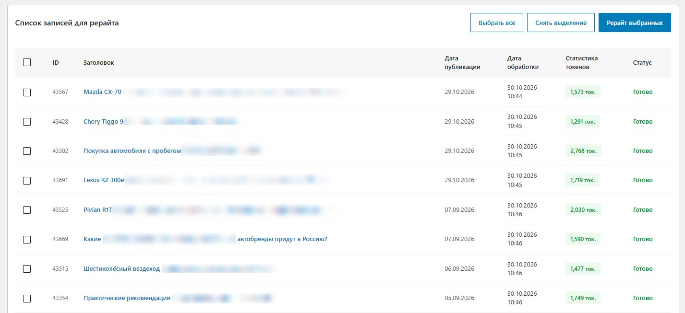

# GigaChat Рерайт Постов

  

## Массовый рерайт записей WordPress через GigaChat API

**GigaChat Рерайт Постов** — мощный инструмент для автоматического переписывания заголовков и текстов статей с помощью нейросети GigaChat от Сбера. Идеально подходит для SEO-оптимизации, повышения уникальности контента и обновления старых публикаций без потери смысла.

[Описание](#о-плагине) · [Установка](#установка) · [Использование](#использование) · [Лицензия](#лицензия)

---

## О плагине

Плагин позволяет выбрать конкретные опубликованные записи и запустить их массовый рерайт прямо из админки WordPress. Он поддерживает раздельные промпты для заголовков и основного текста, ведет точный учет затраченных токенов и предоставляет детальное логирование для отладки.

### Ключевые возможности:
*   **Умная сортировка:** Сортировка списка статей по ID, дате публикации и статусу обработки (Готово/Ожидание) прямо в браузере.
*   **Удобное выделение:** Поддержка выделения диапазона статей через зажатую клавишу `Shift`.
*   **Сохранение медиа:** Жесткий контроль за тегами `` — плагин сохраняет картинки с внешними ссылками и атрибутами в исходном виде.
*   **Раздельные промпты:** Независимая настройка инструкций для генерации заголовка и основного контента.
*   **Статистика токенов:** Отображение количества входных, выходных и общих токенов для каждой обработанной статьи.
*   **Безопасная очистка:** Автоматическое удаление рассуждений модели (`<reasoning>`), HTML-оберток документа и мусорных вступлений.
*   **Отладочный лог:** Запись всех этапов работы и ответов API в файл `gcr-debug.log` с корректной кодировкой UTF-8.
*   **Совместимость:** Полностью работает на обычном шаред-хостинге без необходимости доступа к SSH или конфигам сервера.

---

## Установка

1. Скачайте ZIP-архив из раздела **Releases**.
2. Перейдите в админке: **Плагины → Добавить новый → Загрузить плагин**.
3. Выберите файл `gigachat-rewriter.zip` и нажмите **Установить**.
4. Активируйте плагин.
5. Перейдите в раздел **Консоль → GigaChat Рерайт** для первоначальной настройки.

---

## Использование

1. Получите **Authorization Key** в личном кабинете [Sber AI Studio](https://developers.sber.ru/studio).
2. Вставьте ключ в поле настроек плагина, выберите тип доступа (Scope) и модель.
3. Настройте промпты под свои задачи (по умолчанию уже заданы качественные шаблоны для сохранения структуры и картинок).
4. Перейдите на вкладку **"Список записей для рерайта"**.
5. Выделите нужные статьи галочками (можно использовать `Shift` для массового выделения).
6. Нажмите кнопку **"Рерайт выбранных"** и дождитесь завершения обработки.

> **Совет:** После обработки вы можете отсортировать список по столбцу "Статус", чтобы быстро найти еще не обработанные статьи.

---

## Скриншоты

  
   <em>Настройки подключения и промптов</em>

  
   <em>Выбор записей, сортировка и запуск массового рерайта</em>

---

## Лицензия

Copyright © 2024–2026 Elizarov_n906

Этот плагин распространяется под лицензией **GNU General Public License v2 (GPLv2)**.  
Это означает, что вы можете свободно использовать, изменять и распространять плагин при условии сохранения открытости исходного кода и указания авторства.

   
  Разработано — <a href="https://github.com/elizarov-n906">Elizarov_n906</a>

